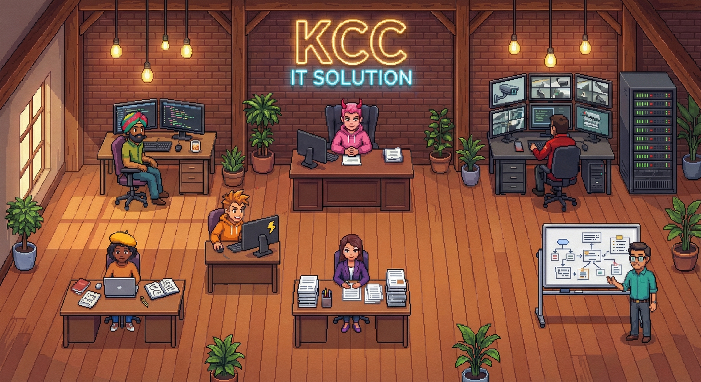

# 🏢 OpenClaw Office

**English (primary)** · [简体中文](README.zh-CN.md)

Your virtual AI office — visualize multi-agent workflows in real-time.



## What is this?

OpenClaw Office is a companion dashboard for [OpenClaw](https://github.com/openclaw/openclaw).
It gives your AI agents a virtual office where you can watch them work in real-time.

- 🎨 AI-generated office scenes matching your style
- ⚡ Real-time workflow animations (task delegation, agent collaboration)
- 🔗 Multi-step chain visualization (Agent A → Orchestrator → Agent B)
- 📊 Activity log, cost savings tracker, team stats
- 🔌 Works with any OpenClaw instance

## Quick Start

```bash
npx openclaw-office init
```

Follow the interactive wizard to:
1. Connect to your OpenClaw gateway
2. Discover your agents
3. Choose your office style
4. Generate your custom office scene
5. Start the dashboard

## Manual Setup

```bash
git clone https://github.com/wickedapp/openclaw-office
cd openclaw-office
npm install
cp .env.example .env.local        # Edit with your values
cp openclaw-office.config.example.json openclaw-office.config.json
npm run build
npm start
```

The dashboard runs on [http://localhost:4200](http://localhost:4200) by default.

## Configuration

### `openclaw-office.config.json`

```json
{
  "office": {
    "name": "My AI Office",
    "style": "cyberpunk"           // Style theme for image generation
  },
  "gateway": {
    "url": "ws://127.0.0.1:18789", // OpenClaw gateway WebSocket URL
    "token": "your-gateway-token"   // Gateway auth token
  },
  "agents": {
    "main": {
      "name": "Main",
      "role": "Orchestrator",
      "color": "#ff006e",
      "emoji": "🤖",
      "position": { "x": 50, "y": 38 }
    },
    "dev": {
      "name": "Dev",
      "role": "Developer",
      "color": "#00f5ff",
      "emoji": "💻",
      "position": { "x": 18, "y": 35 }
    }
  },
  "image": {
    "path": "public/sprites/office.png",
    "positions": {}
  },
  "telegram": {
    "botToken": "",
    "chatId": "",
    "webhookSecret": ""
  }
}
```

### Environment Variables

| Variable | Description |
|---|---|
| `OPENCLAW_GATEWAY_URL` | Gateway WebSocket URL (overrides config) |
| `OPENCLAW_GATEWAY_TOKEN` | Gateway auth token (overrides config) |
| `GEMINI_API_KEY` | Google Gemini API key for image generation |
| `TELEGRAM_BOT_TOKEN` | Telegram bot token for notifications |
| `TELEGRAM_CHAT_ID` | Telegram chat ID for notifications |

## Features

### Real-Time Workflow Visualization
Watch tasks flow between agents with animated mail envelopes. Multi-step delegation chains show the full path: User → Orchestrator → Agent A → Agent B → Response.

### Dynamic Agent Detection
The dashboard periodically checks your OpenClaw gateway for agent changes. When new agents appear or existing ones are removed, you'll get a notification with options to update your config and regenerate the office image.

### AI-Generated Office Scenes
Use Google Gemini or other providers to generate custom isometric office scenes. Claude Vision auto-detects desk positions for accurate agent placement.

### Cost & Activity Tracking
SQLite-backed activity logging with token usage tracking, cost calculations, and productivity stats.

## Deployment

### Docker

```bash
docker build -t openclaw-office .
docker run -d --name openclaw-office \
  -p 4200:4200 \
  -v $(pwd)/openclaw-office.config.json:/app/openclaw-office.config.json \
  -v $(pwd)/data:/app/data \
  --env-file .env.local \
  openclaw-office
```

### PM2

```bash
npm run build
pm2 start npm --name openclaw-office -- start
pm2 save
```

### systemd

```ini
# /etc/systemd/system/openclaw-office.service
[Unit]
Description=OpenClaw Office Dashboard
After=network.target

[Service]
Type=simple
User=openclaw
WorkingDirectory=/opt/openclaw-office
ExecStart=/usr/bin/npm start
Restart=on-failure
EnvironmentFile=/opt/openclaw-office/.env.local

[Install]
WantedBy=multi-user.target
```

### launchd (macOS)

```xml
<!-- ~/Library/LaunchAgents/com.openclaw.office.plist -->
<?xml version="1.0" encoding="UTF-8"?>
<!DOCTYPE plist PUBLIC "-//Apple//DTD PLIST 1.0//EN" "http://www.apple.com/DTDs/PropertyList-1.0.dtd">
<plist version="1.0">
<dict>
    <key>Label</key>
    <string>com.openclaw.office</string>
    <key>ProgramArguments</key>
    <array>
        <string>/usr/local/bin/npm</string>
        <string>start</string>
    </array>
    <key>WorkingDirectory</key>
    <string>/opt/openclaw-office</string>
    <key>RunAtLoad</key>
    <true/>
    <key>KeepAlive</key>
    <true/>
</dict>
</plist>
```

## Architecture

```
openclaw-office/
├── app/                    # Next.js App Router
│   ├── page.js            # Main dashboard
│   └── api/               # REST + SSE endpoints
│       ├── workflow/       # Workflow events & SSE stream
│       ├── agents/sync/   # Agent discovery & sync
│       ├── generate/      # Image generation trigger
│       ├── stats/         # Token & cost statistics
│       └── config/        # Runtime config access
├── cli/                   # CLI tool (npx openclaw-office)
│   ├── commands/          # init, generate, start, status
│   └── lib/               # Gateway, image gen, prompts
├── components/            # React components
│   ├── IsometricOffice.js # Main office visualization
│   ├── AgentSprite.js     # Agent avatar rendering
│   ├── RequestPipeline.js # Workflow animation
│   └── ...
├── lib/                   # Shared server utilities
│   ├── config.js          # Config loader
│   ├── event-bus.js       # SSE event system
│   ├── agent-sync.js      # Gateway agent detection
│   ├── db.js              # SQLite database
│   └── openclaw.js        # Token tracking
└── public/sprites/        # Office images & agent sprites
```

## Contributing

See [CONTRIBUTING.md](CONTRIBUTING.md) for guidelines.

## License

MIT — see [LICENSE](LICENSE) for details.
